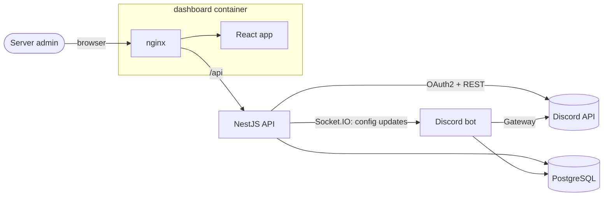

# FazBots

Moderation and management bots for large Discord communities, with a web dashboard to configure everything without touching code.

FazBots ran as a paid SaaS from 2021 to 2025: **30 subscribing servers** (communities with 5k+ members each), reaching **150k+ members** at its peak. Each client server had its own bot instance, configured through the dashboard and updated in real time.

> Resumo em português: o FazBots foi um SaaS de bots para Discord que operei de 2021 a 2025, com 30 servidores assinantes e mais de 150 mil membros no pico. Este repositório reúne o bot, a API e o dashboard, e sobe tudo com Docker.

## Features

**Bot**
- Moderation: ban, kick, mute, timeout, role management, ban logs
- Protection: anti-raid role protection, anti-ban, disconnect protection, blacklist
- Member verification and registration flows with buttons
- Welcome messages and live member counters
- Activity tracking: message counter and ranking, voice-time counter, active-member roles
- Economy and fun: coins earned in chat and voice, marriages, teams and clans, games
- Support tickets and voice support channels
- Instagram feed for partner influencers, with like and comment buttons

**Dashboard**
- Login with Discord (OAuth2) and a list of the servers you manage
- 20+ configuration pages: prefix, welcome message, verification, permissions, VIP, member and voice counters, active members, influencers, logs and more
- Changes are pushed to the running bot instantly over WebSocket

## Architecture



- **Dashboard** (`/dashboard`): React + TypeScript, served by nginx. nginx also proxies `/api` to the API, so the session cookie stays on the same origin.
- **API** (`/api`): NestJS + TypeORM. Handles Discord OAuth2 with Passport, stores sessions in Postgres, checks the user's role permissions with a guard, and emits configuration changes over a Socket.IO gateway.
- **Bot** (`/bot`): discord.js v14 + TypeORM. Loads each server's configuration from Postgres on startup and listens to the API's WebSocket to apply changes without a restart.
- **Database**: PostgreSQL shared by the API and the bot.

## Tech stack

TypeScript · Node.js · NestJS · discord.js · React · TypeORM · PostgreSQL · Socket.IO · Passport (Discord OAuth2) · Jest · Docker · nginx

## Running with Docker

You need Docker and a Discord application.

1. **Create the Discord application** at the [Developer Portal](https://discord.com/developers/applications):
   - Under **OAuth2**, copy the Client ID and Client Secret, and add the redirect `http://localhost:8080/api/auth/redirect`.
   - Under **Bot**, create the bot, copy its token, and turn on the **Server Members** and **Message Content** intents.
2. **Configure the environment:**
   ```bash
   cp .env.example .env
   ```
   Fill in `POSTGRES_DB_PASSWORD`, `COOKIE_SECRET`, `DISCORD_CLIENT_ID`, `DISCORD_CLIENT_SECRET` and `TOKEN`.
3. **Start everything:**
   ```bash
   docker compose up --build
   ```
4. Open **http://localhost:8080**, log in with Discord and pick a server where the bot is installed.

The database schema is created automatically by TypeORM on first start.

| Service | What it runs | Port |
| --- | --- | --- |
| `db` | PostgreSQL 15 | internal |
| `api` | NestJS API + WebSocket | internal (3001) |
| `bot` | discord.js bot | none |
| `dashboard` | nginx + React build | 8080 |

## Running without Docker

Each folder is a standalone Node project. With a local Postgres and a `.env` in each folder:

```bash
cd api && npm install && npm run start:dev        # http://localhost:3001
cd bot && npm install && npm run dev
cd dashboard && npm install && npm start          # http://localhost:3000
```

For local development, set `FRONTEND_URL=http://localhost:3000` and `DISCORD_REDIRECT_URL=http://localhost:3001/api/auth/redirect`.

## How it ran in production

The original deployment used 3 Linux VPS with about 10 bot instances each: one bot per client server, each with its own token, kept alive by PM2. The website and API sat behind Nginx. With Docker, the same model means running one `bot` service per client token.

## Notes

- All credentials come from environment variables. `.env` is git-ignored and `.env.example` lists every variable.
- The "Seja Membro" button used to check a member's Discord bio. That endpoint only works with a user-account token, which Discord's Terms of Service don't allow, so the check is disabled in this version.
- The Instagram feed uses an unofficial client library and is optional: it only runs when `IG_USERNAME` and `IG_PASSWORD` are set.

## Credits

The API and dashboard started from the structure taught in the Discord Bot Dashboard tutorial series by [Anson (stuyy)](https://github.com/stuyy), and were then extended with the FazBots features, pages and WebSocket integration. The bot was scaffolded with [slappey](https://github.com/stuyy/slappey).

## Author

**João Staccioli** · [GitHub](https://github.com/StaccioliJoao)
